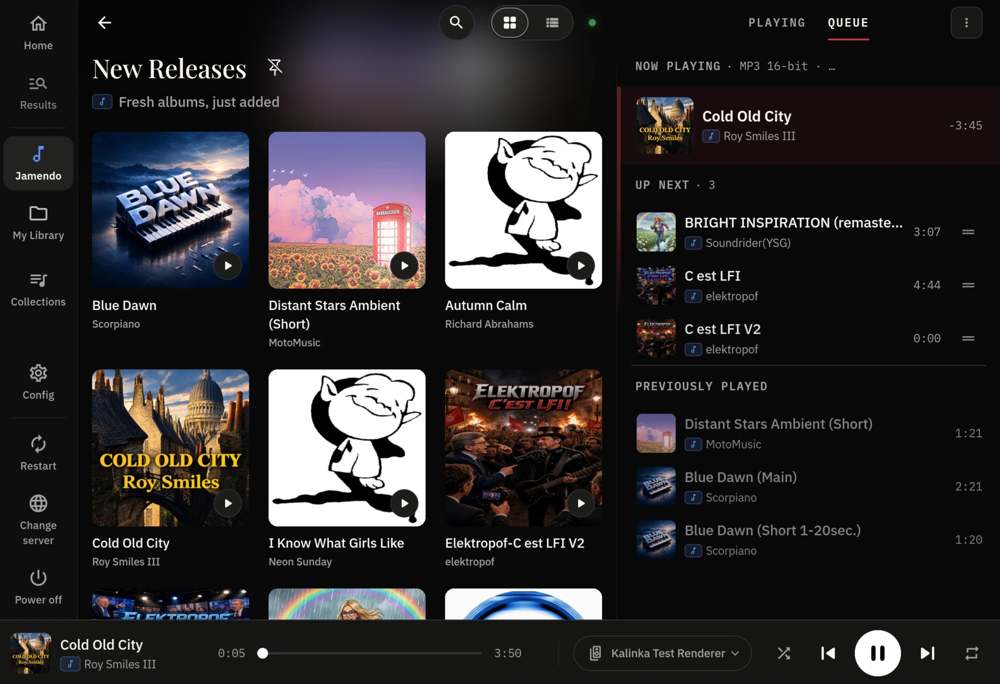

<div align="center">

<picture>
  <source media="(prefers-color-scheme: dark)" srcset="docs/images/kalinka_logo.svg">
  
</picture>

### Self-hosted Hi-Fi for Raspberry Pi and Linux

Bit-perfect playback of your own music library, with search that runs on the device. No cloud, no subscription, no account.

[](https://github.com/Kalinka-Player/KalinkaPlayer/actions/workflows/release.yml)
[](https://github.com/Kalinka-Player/KalinkaPlayer/actions/workflows/renderer-release.yml)
[](https://github.com/Kalinka-Player/KalinkaPlayer/releases/latest)
[](LICENSE)
[](#requirements)
[](https://ko-fi.com/madenvel)

**[Flash an image](https://github.com/Kalinka-Player/KalinkaPlayer/releases?q=kalinka-image-v&expanded=true) · [Releases](https://github.com/Kalinka-Player/KalinkaPlayer/releases/latest) · [Control app](https://github.com/Kalinka-Player/KalinkaAI) · [kalinkaplayer.com](https://kalinkaplayer.com) · [Help test it](https://github.com/Kalinka-Player/KalinkaPlayer/discussions/133)**



</div>

## What is it

Kalinka is a music player for home-built streamers. It runs on a dedicated computer or a single-board computer such as a Raspberry Pi 4, with or without a display, and is controlled from a phone, a desktop computer or a web browser.

It indexes and plays a music library kept on the streamer itself or on a NAS, and plays streaming services through plugins.

Kalinka is not based on MPD. It has its own renderer, which plays directly to ALSA.

## Installation

1. Install the server. On a Raspberry Pi or a spare PC, [flash a ready-made image](docs/installation.md#install-the-server): Kalinka is already on it and plays as soon as the machine starts. On a machine that already runs Debian 13, Raspberry Pi OS (64-bit, Trixie), DietPi or Ubuntu 24.04, one command installs everything:

   ```bash
   sudo apt install -y ca-certificates curl python3
   curl -fsSL https://kalinkaplayer.com/install.sh | sudo bash
   ```

   Kalinka also runs in a [virtual machine](docs/installation.md#c-virtual-machine).

2. Open a remote. Install the [Kalinka app](https://github.com/Kalinka-Player/KalinkaAI#install) for Android, Windows, macOS or Linux, which finds the server by itself, or open `http://<server-address>:8000` in a browser.
3. Follow the setup the app shows. It asks where the music is and where the sound should come out. There are no configuration files to edit.
4. Add music, and more outputs if needed. [Copy music onto the server or point it at a NAS](docs/installation.md#put-your-music-on-it). For another room, [put a renderer on a Linux computer next to an amplifier, or play in a browser tab](docs/installation.md#add-more-outputs).

A server that is not on the network yet can be set up from a laptop over its own temporary Wi-Fi. Join `Kalinka-Setup-XXXX` with the password `kalinka-setup`, stay connected although it has no internet, and open `http://192.168.4.1`. [Connect your streamer to the network](docs/installation.md#connect-your-streamer-to-the-network) has the full steps, and covers Bluetooth setup from the app.

The [installation guide](docs/installation.md) covers the rest: the images, virtual machines, Wi-Fi and logins, the supervisor, updates and troubleshooting.

## Features

### Library

Kalinka indexes the music folders it is pointed at and watches them for changes. It repairs their metadata from MusicBrainz, Wikidata and Deezer, and identifies recordings by AcoustID fingerprint once an AcoustID key is added. Where no source has a match, it falls back to the file names. Cover art is extracted and cached, and generated where there is none.

### Smart Search

Search accepts a description of the music as well as a name: *"dreamy ambient guitar"* returns tracks that fit. In My Library, a CLAP model analyses the audio itself. For Jamendo, the query is matched against a prebuilt index of track descriptions. Smart Search is opt-in and is turned on per plugin.

### Playback

The renderer is a C++ program with direct ALSA access. It plays FLAC, WAV, MP3 and Ogg Vorbis. FLAC and WAV playback includes 24-bit/96 kHz and 24-bit/192 kHz, and WAV also plays as 32-bit PCM and float on outputs that accept them. Consecutive tracks of the same format play without a gap. Mono and stereo DSD files, in DSF or uncompressed DFF, play as native DSD or DoP through a direct ALSA output that supports it, at fixed volume, once DSD output is selected in the renderer's settings.

The renderer does not alter the samples unless software volume is turned on. Whether they reach the DAC unchanged depends on the ALSA device it plays to: a `hw:` device takes them as they are, `plughw:` resamples and reformats whatever the card does not accept, and `default` or a sound server mixes them with other audio. The app shows whether the current route is 1:1. A resampler configured elsewhere in the ALSA stack is invisible to it: playback should still work, but may no longer be bit-perfect.

Playback in a browser goes through the browser's audio stack, so it is not gapless and not guaranteed to be bit-perfect.

The renderer was developed and tested on a Raspberry Pi 4 with a HiFiBerry Digi2 card set up according to its manual. It should work with any ALSA-compatible card, though some may need workarounds.

### Outputs

A renderer installed on any Linux computer on the network appears in the app as an output. Renderers find the server over mDNS and upgrade themselves. The server also serves a web player, so a browser can be both a remote control and an output.

### Plugins

Music sources, metadata enrichers and device integrations are plugins: ordinary Python packages that the server discovers at runtime. My Library, Jamendo and a [UPnP renderer input](packages/kalinka-plugin-upnp/README.md) are included, and a MusicCast plugin controls the volume and power of Yamaha devices. The app installs, updates and removes further plugins from the public catalog.

### Settings

The app and the browser player guide the first setup, and every setting stays editable from the app afterwards. Common settings come first, and an `about:config`-style search reaches the rest.

### Updates

The server checks for new releases every hour. With auto-upgrade on, it installs them during quiet hours while playback is stopped. Otherwise the app offers an update button. The server, plugins, browser player and renderers are upgraded together, renderers first, so a server and a renderer never end up on versions that cannot play together.

## Requirements

Kalinka needs a 64-bit operating system: packages are built for arm64 and amd64 only. On a Raspberry Pi that means the Kalinka image, Raspberry Pi OS (64-bit) or DietPi (64-bit). The Pi 1, Pi 2 and original Pi Zero are not supported.

| Configuration | Minimum hardware | Notes |
|---|---|---|
| Playback and library | Raspberry Pi 3 or Zero 2 W, or any arm64 or amd64 computer with 512 MB of RAM | At 512 MB, use a headless OS and enable swap for the first install and for large scans. 1 GB is comfortable. |
| With Smart Search | Raspberry Pi 4B with 2 GB of RAM, or any arm64 or amd64 computer with 2 GB or more | Measured on a 4 GB Pi 4B: about 1.15 GB in use with the library indexed and idle, and about 1.5 GB at the peak, during the CPU-heavy embedding pass. 2 GB should therefore be enough, but only 4 GB has been tested end to end. Allow about 1 GB of extra disk space. |

Smart Search can be switched on later, so an installation can start on a small board and enable it once the library has moved to a bigger one.

## Feedback

Kalinka is a young project, and many of its problems only show up on other people's hardware and with other people's music. If you try it, say how it went in the [testing thread](https://github.com/Kalinka-Player/KalinkaPlayer/discussions/133): what it ran on, where the music is stored, what it played through, and where you got stuck. Setup questions belong there too. Something you can reproduce is easier to act on as an [issue](https://github.com/Kalinka-Player/KalinkaPlayer/issues).

## Development

[CONTRIBUTING.md](CONTRIBUTING.md) says which issues and pull requests are accepted, and carries the project's disclosure on AI-assisted development.

- [Architecture](docs/architecture.md): how the pieces fit, the package layout, the REST and WebSocket API, configuration and tuning
- [Development](docs/development.md): building the Debian packages, running from source, tests
- [Renderer design](docs/native-renderer-design.md): the contract a renderer implements
- [Plugin catalog design](docs/plugin-catalog-design.md): discovery, installation, compatibility checks and updates
- [TIDAL plugin](https://github.com/Kalinka-Player/kalinka-plugin-tidal): account sign-in, discovery catalogs, collection browsing and lossless streaming
- [Appliance images](packages/kalinka-image/README.md): how the ready-to-flash images are built
- [Releasing](RELEASING.md): the version model and the release procedure

## License

The source code is under **GPL-3.0-or-later**: see [LICENSE](LICENSE).

The visual assets are not. The Kalinka logo, icon and related artwork under `docs/images/` are covered by the [Kalinka Asset License](LICENSE-ASSETS) and need the author's permission to use. Fork the code freely, but put your own branding on it.

Third-party components and their terms are listed in [THIRD-PARTY-NOTICES.md](THIRD-PARTY-NOTICES.md).
