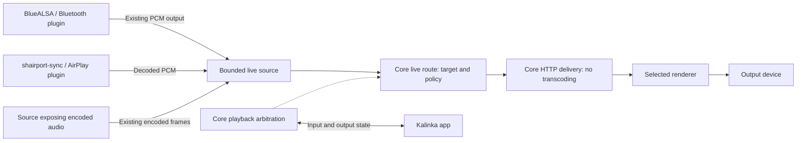

# Bluetooth and AirPlay live audio: transport, latency and architecture

Status: implemented, 2026-11-02; Pi5 Bluetooth playback is confirmed, and switching between Pi5 and laptop renderers was exercised. Physical end-to-end latency measurements and the remaining hardware matrix are still pending. The sections below retain the research and design rationale; this implementation summary records the concrete contract and remaining limits.

Follow-on proposal: [Receiver controls and device management](receiver-controls-design.md) moves discovery, pairing and audio-access operations out of plugin settings into an optional SDK controller and a shared app entry point. It preserves the media architecture below; that control/UI extension is not implemented yet.

Pre-change baseline inspected: KalinkaPlayer `506a9bb10689a537dfeb201234a2a48d744947b7` and the sibling `kalinka-plugin-airplay` checkout at `1a6293694c0a62ffec6d1b94c036576562f20f56`. Local links below refer to the current tree; AirPlay links are pinned to the inspected revision. External sources were checked on the date above.

## Implementation delivered

- **SDK 3.21:** `InputPluginContext.live_audio`, `PcmFormat`, `LivePolicy`, a bounded `LiveSource`, and `DirectPlaybackSession.play_live()`. Producers publish whole frames on the event loop and own source closure. Core owns epoch/frame numbering, retention, route URLs and HTTP responses. Old `LiveCapture` and ordinary sequential URLs keep their existing behavior.
- **Core:** `live_audio.py` supplies a 200 ms default retention ring, split into records of at most 10 ms. Each route has an opaque ID, one reader and an immutable format/epoch. Headers arrive before output readiness; media starts with frames captured **after** readiness. An output move preserves the source and hold, validates the acquired renderer's `live_pcm >= 1`, and retires the old reader. A failed capability preflight preserves the previous output. Pause discards the output queue; resume and transport recovery start fresh. A temporary selected-renderer loss keeps input ownership while reconnecting.
- **Renderer:** live PCM v1 supports interleaved mono/stereo, 8–768 kHz, `S16_LE`, `S24_3LE`, `S24_LE`, `S32_LE` and `FLOAT_LE`. This is the transport ceiling, not a promise that every DAC supports every format. PCM records are decoded without a codec conversion. The decoder queue is 30 ms; ALSA requests 5 ms periods and a buffer derived from the live target, overriding file-playback buffering only for this stream. Default target is 60 ms and maximum reported lag is 250 ms; neither value measures the upstream Bluetooth/AirPlay delay.
- **Clock crossing:** only the live decoder uses libsoxr's variable-rate mode, one thread, with a slow queue-depth controller limited to ±1000 ppm after a two-second observation interval. The resampler processes audio at unity rate from the first frame, avoiding a second filter startup during playback. Samples are unchanged across Core transport; the renderer may resample them to track its independent DAC clock. This is clock adaptation, not network compression. Native fixed-rate conversion beyond that range remains subject to the selected ALSA device/plug configuration. See [libsoxr's variable-rate example](https://github.com/chirlu/soxr/blob/master/examples/5-variable-rate.c).
- **Feedback:** a prepared renderer reports `live_ready`; while playing it reports an absolute audible source-frame estimate every 250 ms, using source/output mapping and ALSA queued-frame delay. Core matches the session and source token, and retires/rebinds a route that exceeds its lag budget. Recoverable HTTP errors surface as buffering. There are no comparisons of unrelated hosts' monotonic clocks.
- **Bluetooth:** new `packages/kalinka-plugin-bluetooth`, disabled by default, uses BlueALSA's A2DP-sink PCM source descriptors and BlueZ AVRCP. It includes receiver supervision, metadata, volume routing, takeover handling, persistent per-phone audio authorization and a two-minute pairing action. BlueALSA decoding remains upstream; no `bluealsa-aplay` owns a DAC. Pairing and supervisor BLE provisioning take the same per-adapter advisory lease. Audio revocation does not delete the shared BlueZ bond. See the [setup guide](../packages/kalinka-plugin-bluetooth/README.md).
- **AirPlay:** the sibling checkout now publishes shairport-sync's actual `S24_3LE` output through the same API. The FLAC child, stdbuf probe, media spool, 16-bit narrowing and plugin prebuffer are removed. Source metadata is descriptive; `OutputFormat` determines how bytes are read. Artwork stays at `/content/airplay/art-*`; audio uses Core `/live-audio/*`. Pause/seek/format changes close the interrupted source and create a fresh source for subsequent audio; renderer changes preserve it. The acquisition task is separate from PCM draining.

### Wire and lifetime contract

One continuous HTTP response per route, not one URL per audio block. Media type is `application/vnd.kalinka.pcm`, with unknown response length, `Accept-Ranges: none`, `Cache-Control: no-store, no-transform`, `Content-Encoding: identity` and `X-Accel-Buffering: no`. An initial zero-byte range probe is accepted as a full live response; arbitrary byte seeking is rejected.

The 32-byte little-endian header (`<8sIHHIIII`) carries magic `KALPCM1\0`, sample rate, channels, layout code, epoch, target milliseconds, maximum milliseconds and zero reserved bits. Codes 1–5 correspond to the layouts listed above. Each 16-byte record header (`<QII`) carries absolute first source frame, frame count and payload byte count, followed by unmodified PCM. HTTP chunk boundaries are unrelated to record boundaries. A change of epoch ends every old route. A renderer cannot reuse a consumed URL or recover at a byte offset.

Sources are limited to four per plugin and 32 per Core, at most 16 MiB each. Their retention ceiling is independent of startup buffering. Slow readers never backpressure the producer: old source blocks are evicted; an evicted or stale cursor ends the route. A source pause with no incoming bytes eventually expires its reader; an active hold can start another fresh route.

### Upgrade and verification limits

Upgrade SDK/Core, all selected renderers, and the supervisor before enabling the new Bluetooth plugin or migrated AirPlay plugin. Native builds now require libsoxr headers and library. Debian Bluetooth packaging installs BlueALSA dependencies, service and D-Bus policy; the Fedora server bundle includes the optional plugin and service assets. Administrators explicitly enable `kalinka-bluealsa.service` after choosing the adapter's audio manager; package installation does not replace a running desktop Bluetooth manager.

Automated coverage includes source retention/readiness/HTTP semantics, output moves between identical-capability renderers, legacy-renderer rejection, pause/reset/takeover, PCM layouts, malformed records, simulated two-hour clock drift, real private-bus D-Bus FD passing, pairing lease exclusion, and AirPlay subprocess/metadata/control tests. These are software checks; the ALSA null device and fake receivers cannot establish Pi CPU cost, audible quality, Bluetooth codec interoperability or actual end-to-end latency.

Remaining hardware acceptance work: local and remote Pi runs, long playback with independent hardware clocks, actual SBC/optional-codec phones, pairing alongside BLE provisioning, loaded Wi-Fi/Ethernet, DAC underruns and AirPlay video lip sync. BlueALSA `ClientDelay` reporting, a UI latency dashboard, encoded-packet passthrough, fixed-rate resampling beyond drift correction and alternative local IPC are outside this first implementation. No automatic compression fallback is provided.

## Recommendation

**Implement Bluetooth as a server-side input plugin, using BlueZ plus BlueALSA on Kalinka appliances. Minimize processing on the input Pi: preserve a receiver's existing encoded stream when it can be exposed cleanly and decoded by the renderer; forward PCM when that is what the receiver already produces. Core transports the supplied representation without encoding or transcoding it. Reuse playback arbitration and HTTP delivery, and add a reusable live-audio policy for latency, freshness and recovery.**

The Bluetooth receiver belongs on the machine with the Bluetooth adapter. That machine need not own the DAC: the selected Kalinka renderer can be local or on another machine. Only the renderer opens the playback device. Display input ownership and output selection independently, for example: **Bluetooth · Alice's phone → Kitchen renderer**.

For the existing shairport-sync and proposed BlueALSA integrations, their exposed audio is already PCM. Use **live PCM over HTTP**, a bounded memory buffer and a new live PCM reader in the renderer. Remove AirPlay's extra PCM → FLAC → PCM conversion. Do not add a transport encoder, compression preference, locality-dependent codec selection or automatic transcoding fallback. Plugins own input reception and metadata; Core owns media delivery; the renderer owns decoding where encoded data is available.

The capture source outlives any one renderer route. On an output switch, preserve the Bluetooth/AirPlay connection and input ownership, negotiate a new route, and start at a fresh decodable boundary. A short playback gap is acceptable; restarting the upstream receiver or replaying old audio is not. This needs an additive live-source SDK contract and renderer support. The representation comes from the source and normally stays the same across local and remote output.

**Spend LAN bandwidth to avoid unnecessary CPU work.** Wired networking is the recommended remedy when Wi-Fi cannot sustain the stream reliably. Do not add adaptive compression, a local/remote compression switch or a FLAC fallback to accommodate that case. Keep a small jitter reserve and recover to fresh audio after stalls; increasing the buffer indefinitely would defeat the latency requirement.

DSD512 is an uncommon workload used here only as a bandwidth comparison, not a requirement for Bluetooth/AirPlay or a reason to complicate their transport. Stereo DSD512 is about **45.16 Mbit/s (5.64 MB/s)**; the 768 kHz/32-bit stereo PCM example is **49.15 Mbit/s (6.14 MB/s)**. These examples are around **50 Mbit/s**, not 50 MB/s (400 Mbit/s). Current AirPlay's PCM requires only **2.304 Mbit/s (0.288 MB/s)** at its maximum configured rate.

## Baseline findings before implementation

| Finding in the inspected code | Design implication |
|---|---|
| [AirPlay](https://github.com/Kalinka-Player/kalinka-plugin-airplay/blob/1a6293694c0a62ffec6d1b94c036576562f20f56/README.md) runs shairport-sync, receives PCM and metadata, encodes FLAC and serves it through `LiveCapture`. Its renderer may be remote. | The same integration approach satisfies Bluetooth input with independently selected output. |
| [`DirectPlayback`](../packages/kalinka-plugin-sdk/src/kalinka_plugin_sdk/direct_playback.py) acquires the selected renderer outside the queue. [`PlaybackControl`](../packages/kalinka-plugin-sdk/src/kalinka_plugin_sdk/datamodel.py) exposes the owning plugin, title and seekability. | Acquire as “Bluetooth”, with `seekable=False`; preserve the existing queue and source attribution. |
| `DirectPlaybackSession.show()` changes metadata without restarting a sequential stream. | AVRCP track changes should update display without restarting audio. |
| [`ExternalPlayback`](../packages/kalinka-plugin-sdk/README.md) is for an engine that owns output itself. | It is the wrong interface for this route: use `DirectPlayback` so the selected renderer remains responsible for output. |
| [`TrackSource.sequential`](../packages/kalinka-plugin-sdk/src/kalinka_plugin_sdk/inputmodule.py) forbids replay from arbitrary offsets. | Useful for Bluetooth, but it does not express a latency target, maximum age or clock policy. A sequential source is not necessarily a real-time input. |
| [`HolderSession.move_to()` and `_replay()`](../packages/kalinka-server/src/kalinka_server/direct_playback.py) cannot replay a sequential source; switching renderer revokes its hold with `OUTPUT_LOST`. | Keep this behavior for existing sequential URLs. Add a live-source branch that preserves input ownership and rebinds the output with a fresh resource. |
| [`runs_here()`](../packages/kalinka-server/src/kalinka_server/renderer_ws_handler.py) compares the renderer's `Hello.platform.machine_id` with Core's machine identity; [`RendererRecord.local`](../packages/kalinka-server/src/kalinka_server/renderer_registry.py) retains the result. | This can inform endpoint optimization later. PCM delivery does not need to branch on locality. |
| [`OutputCapabilities`](../packages/kalinka-plugin-sdk/src/kalinka_plugin_sdk/direct_playback.py) currently exposes DSD support only. Its [tracker](../packages/kalinka-server/src/kalinka_server/output_capabilities.py) suppresses notifications when capability values have not changed. | A switch between two otherwise identical renderers need not trigger a capability notification. Do not use that watcher as the route-change mechanism. |
| [`LiveCapture`](../packages/kalinka-plugin-sdk/src/kalinka_plugin_sdk/live_capture.py) is file-backed, bounds bytes, and refuses a second open of an unfinished capture. With `keep_delivered=False` it releases delivered storage; overflow fails the capture. | Replace it in the AirPlay media path with the shared bounded memory source. Keep its existing API for other sequential sources; storage bounds alone do not bound audible delay. |
| [`live_content.py`](../packages/kalinka-server/src/kalinka_server/live_content.py) already serves unknown-length HTTP with `Cache-Control: no-store`, `Accept-Ranges: none` and `X-Kalinka-Live: 1`. | Keep these semantics. There is no need for HLS, a complete recording, or repeated polling for segments. |
| [`WavContainer`](../packages/kalinka-renderer/src/native_player/WavContainer.cpp) now supports finite WAV, but checks finite chunk lengths and reads blocks of up to 4,096 frames. | The earlier “unknown-length WAV” proposal is not implemented by merely adding a WAV header. |

The [earlier Bluetooth proposal](first-run-wifi-design.md#7-bluetooth-playback) already chose a plugin and BlueALSA. Keep that direction, but update its assumptions: WAV exists now, indefinite WAV still needs explicit support, the supervisor is Go, BlueZ is already used by provisioning, and the live-stream SDK has advanced. Do not carry forward its proposal to switch off the shared adapter when the audio plugin is disabled. The [current supervisor design](supervisor.md) explicitly keeps playback separate and calls for coordination of pairing.

## Bluetooth backend options

| Option | Fit for Kalinka | Tradeoff | Verdict |
|---|---|---|---|
| **BlueZ + BlueALSA; plugin reads PCM** | Small appliance-oriented integration; keeps native ALSA output in the renderer; remote routing remains ordinary Kalinka routing. | Adds a daemon, D-Bus integration and packaging/version checks. Kalinka must handle timing after PCM capture. | **Default for headless images.** |
| **BlueZ + PipeWire/WirePlumber; plugin captures a dedicated Bluetooth node** | Sensible on desktops already using PipeWire; same plugin/session abstraction can be retained. | Headless session policy, graph routing and automatic links need configuration. PipeWire clock handling inside its graph does not synchronize a separate remote Kalinka renderer. | Optional backend, not a new system-wide dependency for appliances. |
| **Plugin implements BlueZ media endpoints and decodes A2DP itself** | Maximum access to transport packets and timing. | Own codec negotiation, packet handling, decoding, interoperability and recovery. Substantial scope with little initial product benefit. | Reject for the first implementation. |
| **Bluetooth feeds the local DAC directly, e.g. `bluealsa-aplay`** | Convenient bring-up/reference path. | Bypasses selected renderer, arbitration and volume; does not satisfy remote output. | Benchmark only. |
| **Receiver embedded in the renderer** | Can shorten a local path and place the radio near a listening room. | Couples input discovery to output deployment; forwarding to another renderer requires an additional input service anyway. | Future capture-node use case, not the initial design. |

BlueALSA exposes decoded PCM through file descriptors obtained via D-Bus; audio samples do not travel as D-Bus messages. BlueZ provides transport and control APIs, rather than a ready-made PCM decoder for the plugin. [BlueALSA PCM API](https://github.com/arkq/bluez-alsa/blob/v4.3.1/doc/org.bluealsa.PCM1.7.rst), [BlueZ transport API](https://github.com/bluez/bluez/blob/master/doc/org.bluez.MediaTransport.rst).

PipeWire is not inherently incompatible with this architecture: use it as capture infrastructure, prevent automatic local playback, and keep the selected renderer as output owner. WirePlumber documents A2DP sink configuration and a headless seat-monitoring override. Avoid two competing Bluetooth audio managers on the same adapter; choose a backend explicitly. [WirePlumber Bluetooth configuration](https://pipewire.pages.freedesktop.org/wireplumber/daemon/configuration/bluetooth.html).

### Scope and version constraints

Start with **Classic Bluetooth A2DP sink plus AVRCP**, one active sender and one selected output. Enable SBC first; add AAC or other codecs only when the installed decoder build and tested senders support them. HFP/HSP call audio, Bluetooth output and LE Audio are separate features. LE provisioning does not imply LE Audio support. BlueALSA documents which profiles and compiled codecs are available. [BlueALSA 4.3.1 daemon manual](https://github.com/arkq/bluez-alsa/blob/v4.3.1/doc/bluealsa.8.rst).

The checked Debian 13 package is **BlueALSA 4.3.1-3**, whereas upstream documentation has evolved. Pin a supported baseline and introspect optional features. In particular:

| Interface detail | BlueALSA 4.3.1 | Current upstream documentation |
|---|---|---|
| Daemon name | `bluealsa` | `bluealsad` |
| Sample rate property | `Sampling` | `Rate` |
| Volume representation | Packed `uint16` | Byte array |
| Client delay control | `SetDelayAdjustment` / `DelayAdjustment` | Writable `ClientDelay` |

Put these differences in the backend adapter. Do not build against upstream `master` docs and assume the appliance package implements them. Delay-adjustment behavior must be verified before treating the older interface as equivalent to reporting downstream playback latency. [Debian package](https://packages.debian.org/trixie/bluez-alsa-utils), [4.3.1 PCM API](https://github.com/arkq/bluez-alsa/blob/v4.3.1/doc/org.bluealsa.PCM1.7.rst), [upstream PCM API](https://github.com/arkq/bluez-alsa/blob/master/doc/org.bluealsa.PCM1.7.rst), [upstream daemon manual](https://github.com/arkq/bluez-alsa/blob/master/doc/bluealsad.8.rst).

## Component boundaries



The diagram separates control from media delivery; Core hosts both existing interfaces. It does not require a new media server.

Keep using Core's renderer-reachable content URL resolution, rather than handing a remote renderer a loopback URL or a local pipe path. Bind each live resource to its current session/epoch and retain the existing access-control model; expiring a route must also invalidate its old resource.

| Component | Owns | Does not own |
|---|---|---|
| Bluetooth backend adapter | Device/transport discovery, PCM descriptors, format, AVRCP, backend version normalization. | Queue state or renderer selection. |
| Bluetooth plugin service | Sender admission, Bluetooth state machine, PCM publication, metadata, commands and input ownership. | Renderer locality, transport encoding, DAC access or codec implementation. |
| Shared live-audio service in Core | Bounded media storage, framing, media timeline, output-route lifecycle, cancellation and readers. | Bluetooth addresses, pairing, AVRCP or transport compression. |
| Core playback coordinator | Playback arbitration, renderer selection, route policy, content URLs and capability negotiation. | Bluetooth codecs or hardware timing loops. |
| Renderer | Decode, live buffering, clock correction, output latency, hardware and telemetry. | Pairing and source-specific control protocols. |
| Pairing coordinator | Shared adapter settings, pairing-window leases and default-agent ownership. | Audio samples, decoding or playback sessions. |

Keep D-Bus work and PCM reading outside short SDK callback execution. Callbacks enqueue work into the plugin's serialized session state machine. Cancellation must wake descriptor reads, HTTP readers and producer tasks. Never hold the state-machine lock across a potentially indefinite pipe write or network operation.

Keep the SDK limited to a `LiveSource` descriptor, format-specific blocks, a producer handle and live policy. A PCM producer is one implementation, not the only permitted source. Implement buffers, framing and route management in a dedicated Core component. AirPlay and Bluetooth use the same component. Keep the existing `LiveCapture` API for its other users.

## Preserve the representation the receiver already provides

### What AirPlay used before this migration

The inspected AirPlay plugin converts shairport-sync's PCM to **FLAC using the `flac` executable**, with `--compression-level-0`, no seek table/padding and `stdbuf --output=0`. It runs one encoder per uninterrupted segment and serves the result over HTTP. It does not use FFmpeg for this step and has no local-renderer bypass. See [`flac_argv()` and `Segment`](https://github.com/Kalinka-Player/kalinka-plugin-airplay/blob/1a6293694c0a62ffec6d1b94c036576562f20f56/src/kalinka_plugin_airplay/segment.py).

Encoding happens continuously in the plugin as PCM arrives; the content endpoint serves the produced bytes as the renderer reads them. It is not a fresh encoding job for every HTTP request or every audio block. The proposed migration removes this encoder and publishes PCM directly. Core only frames and transports those samples; neither `flac`, FFmpeg nor another compression library is needed for delivery.

### Processing policy

| What the source exposes | Core delivery | Renderer work |
|---|---|---|
| Encoded audio with usable headers and frame boundaries | Forward the encoded representation, with minimal framing/remuxing if needed. | Decode once, then render. |
| PCM already decoded by the receiver | Forward PCM unchanged apart from required framing/packing. | Read samples directly; no codec decompression. |
| DSF/DFF file containing uncompressed DSD | Continue serving the original file bytes. | Parse/repack DSD for the output device; no PCM conversion or network recompression. |

“Decode on the renderer” is the preference when encoded audio is available at a usable boundary. It is not a reason to decode and re-encode a source, or to replace a mature receiver merely to obtain smaller network packets. Compare total CPU on both Pis, process wakeups and latency, not just bytes sent.

The current AirPlay plugin uses shairport-sync's PCM stdout, and BlueALSA's `PCM1.Open()` exposes decoded samples. Selecting AAC/SBC in the Bluetooth backend does not turn its PCM file descriptor into compressed audio. Passing AirPlay ALAC/AAC or Bluetooth codec frames through would require a receiver/backend interface before decoding, preservation of configuration/timing, and matching renderer support. The renderer is not currently an A2DP codec endpoint. Do not acquire BlueZ's transport a second time alongside BlueALSA to try to intercept it. [BlueALSA PCM API](https://github.com/arkq/bluez-alsa/blob/v4.3.1/doc/org.bluealsa.PCM1.7.rst), [shairport-sync configuration](https://github.com/mikebrady/shairport-sync/blob/master/scripts/shairport-sync.conf).

Keep encoded passthrough possible in the generic contract, but start with the existing receivers' PCM output and remove the redundant FLAC round trip. Encoded-frame backend integration is not a prerequisite for this migration. If profiling shows upstream decoding itself is a problem on the smallest Pi, investigate a backend that exposes encoded frames as a distinct project. Protocol decryption, transport handling and metadata remain the receiver's responsibility even when audio decoding moves downstream.

### PCM bandwidth and the actual sample-rate limit

For stereo with 32 stored bits per sample:

```text
payload bytes/s = sample_rate × 2 channels × 4 bytes
payload bits/s  = sample_rate × 64
```

| Sample rate | PCM payload | PCM payload | 200 ms retained PCM |
|---|---|---|---|
| 44.1 kHz | 2.8224 Mbit/s | 0.3528 MB/s | 70.56 kB |
| 48 kHz | 3.072 Mbit/s | 0.384 MB/s | 76.8 kB |
| 96 kHz | 6.144 Mbit/s | 0.768 MB/s | 153.6 kB |
| 192 kHz | 12.288 Mbit/s | 1.536 MB/s | 307.2 kB |
| 384 kHz | 24.576 Mbit/s | 3.072 MB/s | 614.4 kB |
| 768 kHz | 49.152 Mbit/s | 6.144 MB/s | 1,228.8 kB |

These are calculated payload rates in decimal units, excluding record, HTTP, TCP/IP and link overhead. Buffer retention is a storage ceiling, not a required delay. Multiple simultaneous outputs would multiply network traffic; this design initially has one.

**Current Kalinka AirPlay input is configured for 44.1/48 kHz**, with packed 24-bit PCM from shairport-sync. Its maximum current PCM payload is therefore **2.304 Mbit/s**, or **3.072 Mbit/s if represented in 32-bit containers**. The configuration is explicit in [`shairport.py`](https://github.com/Kalinka-Player/kalinka-plugin-airplay/blob/1a6293694c0a62ffec6d1b94c036576562f20f56/src/kalinka_plugin_airplay/shairport.py). A 768 kHz DAC does not make this receiver produce 768 kHz audio.

There is no single hardware-independent maximum sample rate for the generic renderer. [`WavContainer`](../packages/kalinka-renderer/src/native_player/WavContainer.cpp) does not impose a 192 kHz ceiling; [`AlsaAudioEmitter`](../packages/kalinka-renderer/src/native_player/AlsaAudioEmitter.cpp) negotiates the requested rate and rejects a mismatch. The [renderer documentation](../packages/kalinka-renderer/README.md) records automated 96/192 kHz coverage and exposes the selected output's maximum PCM rate. The 384/768 kHz rows are sizing examples, not verified support claims. Actual acceptance requires the source format, live reader, output device and sustained link throughput to support the combination.

For one stream, even the 768 kHz example uses less than half of a nominal 100 Mbit/s link's raw rate, although overhead, contention and actual throughput still matter. At 192 kHz the payload is 12.288 Mbit/s; AirPlay's 32-bit sizing case uses 3.072 Mbit/s. Accept the bandwidth cost of forwarding the receiver's output. If a wireless connection cannot support the selected format within the live latency budget, recommend Ethernet; do not recompress, lower source quality or accumulate seconds of audio automatically. Size and test the transport for negotiated formats rather than claiming an absolute maximum based on link speed alone.

Preserve the source rate and precision: do not upsample or pad all input to 32 bits merely because that is the sizing assumption. A 32-bit container may hold fewer valid bits, or IEEE float rather than integer samples; carry the container width, valid precision and sample format explicitly. Use the received PCM format when supported, with any necessary rate/format adaptation owned by the renderer.

### DSD512 as a bandwidth reference

For the common 44.1 kHz family, DSD512 is 22.5792 million **one-bit** samples per second per channel. Stereo payload is therefore `44,100 × 512 × 2 = 45,158,400 bit/s`, or **45.1584 Mbit/s / 5.6448 MB/s**. Some devices also support the 48 kHz family at 24.576 MHz, whose stereo payload is 49.152 Mbit/s. These are calculated payloads; [exaSound's DSD512 specifications](https://www.exasound.com/Products/e62DAC.aspx) list both sample-rate families.

| Stereo format | Payload Mbit/s | Relative to 44.1-family DSD512 |
|---|---|---|
| Current AirPlay PCM, 48 kHz / packed 24-bit | 2.304 | 5.1% |
| PCM, 48 kHz / 32-bit | 3.072 | 6.8% |
| PCM, 96 kHz / 32-bit | 6.144 | 13.6% |
| PCM, 192 kHz / 32-bit | 12.288 | 27.2% |
| PCM, 384 kHz / 32-bit | 24.576 | 54.4% |
| PCM, 705.6 kHz / 32-bit | 45.1584 | 100% |
| DSD512, 22.5792 MHz / 1-bit | 45.1584 | 100% |
| PCM, 768 kHz / 32-bit | 49.152 | 108.8% |

Thus the user's DSD512 workload has the same raw payload rate as stereo 705.6 kHz/32-bit PCM. AirPlay in a 32-bit container requires about **one fifteenth** of that throughput. DSD512 is rare; it illustrates the available scale of bandwidth, not a typical live-input format or a mandatory benchmark for this feature. The no-transcoding decision applies independently of whether a particular user plays DSD.

For Kalinka's inspected local-file path, [the plugin serves original file content](../packages/kalinka-plugin-localfiles/src/kalinka_plugin_localfiles/localfiles.py), and [`DsdContainer`](../packages/kalinka-renderer/src/native_player/DsdContainer.cpp) parses DSF/DFF on the renderer. Container metadata/padding adds some network traffic; native DSD or DoP packing for the DAC happens downstream. Do not count DoP markers as network overhead unless the network stream itself is DoP. DoP stores 16 DSD bits in a 24-bit word; carrying that representation over the network would add 50% before further container padding. [iFi's DSD/DoP explanation](https://downloads.ifi-audio.com/faqs/how-is-dsd512-transmitted/).

Successful buffered DSD512 playback demonstrates useful sustained throughput on the user's setup, but not the absence of short network stalls. Live audio still needs a bounded jitter reserve, clock adaptation and stale-data recovery. Do not apply PCM resampling or frame-dropping rules to native DSD library playback; it keeps its existing path.

### Separate capture lifetime from route lifetime

The lifecycle below describes the first implementation, whose receiver backends expose PCM. Encoded producers use the same input/route separation with codec-specific decodable restart boundaries.

Maintain three identities:

| Identity | Changes when | Survives |
|---|---|---|
| Input session | Sender is replaced, playback ownership is revoked, or input closes. | Renderer switches and temporary output loss, according to the recovery policy. |
| PCM epoch | Input format/timeline changes or capture has a discontinuity. | An ordinary output switch while capture continues. |
| Route generation | Renderer, renderer instance or output connection changes. | Metadata changes within the same route. |

A plugin publishes PCM once into a small memory ring with epoch, source-frame index and format. Core attaches an output cursor at a recent frame after the renderer is ready, and streams PCM from that cursor. With no route, retain only the bounded recent window. If a reader falls behind the retained window, fail that route and restart it near the live edge.

This is a small rolling buffer, not a recording. Preserve frame indices across dropped blocks so feedback can distinguish intentional loss from clock drift. Use a new PCM epoch for an input discontinuity, and a new route generation for every reader/HTTP restart. An input format change also forces a fresh route header and format negotiation.

### Route policy

The source declares the representation it exposes. Negotiate the matching live-reader/decoder capability, format parameters, latency target and recovery behavior. An older renderer without required support needs an upgrade; do not silently add transcoding as a fallback. Existing plugins using the old sequential URL API retain their existing behavior until migrated.

For encoded live sources, the descriptor must include codec initialization/framing and a way to obtain a fresh decodable start. Bound retention by media duration as well as bytes, and retain the necessary header/configuration. A midstream byte offset is not a universal restart point. The first implementation supplies PCM through this contract; a later encoded producer needs its own verified restart rules rather than inheriting PCM's arbitrary-frame restart assumption.

### Bind against the acquired output, not an earlier observation

Core must resolve a route using an immutable snapshot of the **acquired** target: renderer ID, instance/connection generation, PCM capabilities and selected live policy. Validate that snapshot when committing the route. If selection changes during acquisition or output preparation, cancel the provisional route and resolve again; never attach its reader to the replacement renderer by accident.

There is already a useful boundary in [`RendererPlayer._dispatch()`](../packages/kalinka-server/src/kalinka_server/renderer_player.py): it acquires the session before resolving a content URL for that renderer. Extend this flow for logical live sources so PCM compatibility and live policy are also resolved there, through the shared route service.

Locality is no longer needed to select a codec. If used for endpoint optimization, treat the existing machine-identity comparison as a hint rather than proof of shared sockets or filesystem namespaces. A container can be on the same physical host yet have a different network namespace. Test endpoint reachability through normal session setup.

PCM over the existing renderer-reachable HTTP address works without assuming shared filesystem access. On an ordinary same-host installation, it can use a verified loopback endpoint or the host's local address. A proxy's address or hostname match is not a reason to send a renderer a `localhost` URL. Unix sockets/shared memory should require a separate negotiated local endpoint if added later.

The existing capability watcher remains useful for presentation and format advertisement, but is not sufficient for route management: two renderers can advertise identical capabilities, and the current tracker coalesces that notification. The route coordinator must observe target/instance changes directly.

### Minimal additive SDK shape

The additive SDK 3.21 API implemented for this design:

```python
source = context.live_audio.create_pcm(format=pcm_format, max_buffer_ms=200)
hold = await context.direct_playback.acquire("Bluetooth", listener, seekable=False)
await hold.play_live(source, track, policy=LivePolicy(target_latency_ms=60))

# Producer task: preserve complete frames; never wait for a slow renderer.
source.offer(pcm_block)  # Core assigns epoch/frame numbers.
# On a receiver discontinuity: source.reset(new_pcm_format).
# On disconnect/shutdown: source.close().
```

`play_live()` binds a logical source handle, while the existing `play(TrackSource)` continues to bind a particular representation/URL. `offer()` has bounded-overflow behavior: eviction preserves absolute frame numbering and never grows an unbounded queue. The plugin calls it from a producer task outside SDK callbacks. The 200 ms ring capacity above is an illustrative retention ceiling, not a required startup fill.

Internally, the live route resolves that source into a session-bound content resource, concrete media type, decoder format and source token. Core can reuse the current live-response serving machinery with a Core-owned resource registry; a plugin should not have to expose a fake media asset for every route variant. The renderer protocol gains an explicit versioned live PCM capability, live policy, format preparation/readiness and feedback. Preparation must be possible from the supplied PCM format before media bytes arrive, so waiting for output readiness does not deadlock with waiting for a stream header. None of this requires Bluetooth-specific messages in the renderer.

### Switching outputs without restarting capture

For the new logical live source, keep the input's arbitration hold while replacing its renderer binding. Preserve existing sequential-URL revocation behavior for old plugins. The new coordinator serializes these steps:

1. Reserve/preflight the requested renderer and confirm its PCM capabilities. If preflight fails, keep the existing output where possible and report the failure.
2. Advance the route generation, stop/flush the old output using the existing session lifecycle, and retire its URL and reader. Validate generation checks at every asynchronous completion.
3. Prepare the new renderer's output format. While it settles, continue Bluetooth/AirPlay capture into the bounded ring, discarding older frames.
4. Once ready, choose a current PCM cursor and start a fresh response with its PCM header. Bind the new source token to this route generation.
5. Start after the live jitter target is met. Reset the new renderer's clock estimator and map its relative positions back to the shared PCM timeline. Confirm the output change in UI state.

Local → remote, remote → local, local → local and remote → remote all follow the same PCM route transaction. No codec changes or encoder lifecycles are involved. Do not pause/re-pair the Bluetooth phone or restart shairport-sync because output selection changed.

There may be a short gap; seamless migration would require coordinated presentation clocks and overlapping preparation, which is separate work. For an unreachable old renderer, respect the existing session-loss/expiry rules rather than assuming a stop command was delivered. A queue takeover during any step cancels the whole live hold and all provisional routes; an obsolete completion cannot reclaim it. If the user has already committed to an output that subsequently fails, expose “waiting for output” and retry that target with fresh audio instead of secretly falling back.

AirPlay also needs its downstream latency estimate updated for the new output route. The receiver's current shairport latency offset is written into its configuration; determining whether the pinned receiver can apply a timing correction at runtime is a separate integration check. If it requires restart, preserving uninterrupted capture takes priority and lip-sync behavior must be reported/tested explicitly. PCM delivery removes Kalinka's transcoding cost, not AirPlay's upstream protocol buffering.

### Source identity and visible state

Use the existing exclusive `PlaybackControl` for the active-input label. Acquire with title `Bluetooth`; show sender and available track metadata separately. Keep the selected renderer visible and selectable. Do not create a fake queue track or a Bluetooth output-device plugin just to display the input.

Distinguish these facts:

- **Connected:** a phone has a connection; it has not necessarily taken playback.
- **Receiving / preparing:** valid PCM is arriving and Bluetooth owns the output, but the renderer has not confirmed playback.
- **Playing:** Bluetooth owns the output and the renderer confirms playing.
- **Paused:** the Bluetooth session is selected but silent.
- **Waiting for output / error:** Bluetooth may still be receiving, but no renderer is producing sound.

Use transport activity and actual PCM arrival for audio state. AVRCP `playing` alone is insufficient, and silence samples are still an active stream. If metadata is absent, show “Bluetooth audio” and the device alias. Keep Bluetooth codec, server-to-renderer representation and output PCM format distinct: forwarding decoded SBC as PCM does not restore information lost by SBC. The existing `audio_codec` field describes the renderer source; add structured input details to show the received codec separately and report PCM for the new delivery path.

AVRCP's `MediaPlayer1` provides metadata and transport methods, which can be unsupported by a sender. Use `show()` for track changes, suppress seeking, and handle unsupported controls explicitly. A local pause must silence playback even if remote pause fails; resume then starts fresh audio. [BlueZ player API](https://github.com/bluez/bluez/blob/master/doc/org.bluez.MediaPlayer.rst).

The richer receiver state is proposed, not already supplied by `PlaybackControl`. Keep connection health in module state, actual sound state in renderer state, and add a small generic input-session status if the app needs to distinguish “paused upstream” from the stopped renderer after a flush.

### Session lifecycle and output switching

1. **Connected idle:** observe the device and negotiated format. A connection alone never interrupts the queue.
2. **Fresh play intent:** the first authorized streaming transition acquires `DirectPlayback`, attaches the logical PCM source through `play_live()`, and starts the selected route after the small live startup budget.
3. **Metadata change:** update display without replacing the stream. Bind delayed metadata to the current sender and epoch.
4. **Pause:** stop/flush the renderer and retire the route. Ask the sender to pause when supported. Continue consuming and discarding incoming PCM if it keeps sending; never build a paused recording. Keep the logical input hold according to its idle policy.
5. **Resume or format change:** create a new PCM epoch and independently decodable route at the current live edge. Never change PCM interpretation halfway through a stream.
6. **Queue or another plugin takes over:** stop serving audio, pause the sender where possible, and suppress reacquisition until a new sender play transition or explicit user action. Continuing packets from an ignored pause must not steal output back.
7. **Renderer switch:** follow the route transaction above. Keep input ownership and the current PCM epoch, replace the renderer binding, and preserve the source representation. Expect a brief gap, not seamless migration.
8. **Disconnect, disable or shutdown:** cancel tasks, close descriptors/readers, retire resources and release ownership. Keep the user's queue intact; require an explicit policy before auto-resuming it.

Today `OUTPUT_LOST` covers both a renderer switch and other output loss. AirPlay already reacquires after some revocations. The new `play_live()` contract should instead keep a logical live-source binding in Core and use its serialized route coordinator. This removes the need for plugins to rediscover the target or react to a renderer move as if the phone had stopped. Old sequential-URL plugins retain their existing lifecycle. Do not retry `acquire()` on every PCM block.

When output is temporarily absent, discard PCM and retain only bounded recent audio. Retry with backoff when the intended renderer becomes available. Show the unavailable output. Recovery starts at the live edge; it cannot restore missed sound. For a second phone, initially reject a competing active stream; switching senders must be explicit or governed by a documented last-play-wins policy.

## Where latency comes from

Separate **startup delay**, **steady-state audio delay**, **command-to-silence delay**, and **recovery time**. They are different measurements.

```text
End-to-end audio delay = phone/app buffering + Bluetooth transport/decode
                      + Kalinka capture/encoding + network delivery
                      + renderer queue + ALSA/device delay
```

HTTP pull is not inherently a long-latency mechanism. The renderer opens a response once and consumes audio as it arrives. The problematic behaviors are waiting to fill a large block, excessive queued audio, TCP retransmission stalls and replaying backlog after a stall. Changing the direction of connection establishment does not remove these delays.

### Latency findings in the pre-change implementation

| Layer | Current behavior | Action |
|---|---|---|
| AirPlay startup | [Default prebuffer is 500 ms](https://github.com/Kalinka-Player/kalinka-plugin-airplay/blob/1a6293694c0a62ffec6d1b94c036576562f20f56/src/kalinka_plugin_airplay/__init__.py); the service waits for that much fed PCM. | Do not inherit it for Bluetooth. Start with a measured live policy. |
| AirPlay timing | Its `renderer_delay_ms=300` contributes to shairport's latency-offset calculation. | It is a compensation estimate, not a separate 300 ms queue. Bluetooth needs its own delay-reporting integration. |
| FLAC encoding | [AirPlay uses level 0 and unbuffered stdout](https://github.com/Kalinka-Player/kalinka-plugin-airplay/blob/1a6293694c0a62ffec6d1b94c036576562f20f56/src/kalinka_plugin_airplay/segment.py), including for a local output. | Remove this transport encoder for both local and remote routes; forward the receiver's PCM. |
| Content delivery | The server requests up to 64 KiB; `LiveCaptureReader.read()` returns available bytes without waiting to fill that request. | This is a maximum read size, not a mandatory 64 KiB prebuffer. Retain partial-read behavior. |
| HTTP input | [`AudioGraphHttpStream`](../packages/kalinka-renderer/src/native_player/AudioGraphHttpStream.cpp) recognizes live responses, disables ranges and its ordinary stall timeout, and has bounded storage. | Preserve streaming behavior; add an explicit live liveness/freshness policy rather than waiting on the ordinary file timeout. |
| Renderer buffers | [Shipped defaults](../packages/kalinka-renderer/src/player/NativePlayer.cpp) are 768,000 network bytes and 1,536,000 decoded FLAC bytes. | These are capacities, not unconditional startup waits, but permit substantial stale backlog. Bound live occupancy in time. |
| ALSA output | Shipped settings request **160 ms buffer / 40 ms period**. The low-level emitter's 100/25 fallbacks are overridden by `NativePlayer`. Startup feeds available ALSA capacity before its explicit start. | Apply a per-session live buffer/period policy and inspect actual negotiated values. |
| Hardware setup | Shipped `output.format_change_delay_ms` is **500 ms**; [`setupAudioFormat()`](../packages/kalinka-renderer/src/native_player/AlsaAudioEmitter.cpp) sleeps for it after configuring the device. | Make it hardware-specific. Where necessary, prepare the output and discard old capture before starting; do not preserve the setup wait as steady-state backlog. |
| WAV | `WavContainer::nextBlock()` requests up to 4,096 frames with `readExact()`. | That is about 85 ms at 48 kHz or 93 ms at 44.1 kHz per block. A future live PCM path must read smaller blocks and support an indefinite stream explicitly. |

At 48 kHz, stereo, 16-bit, PCM consumes 192,000 bytes/s. A full 768,000-byte PCM buffer holds four seconds; a full 1,536,000-byte decoded buffer holds eight seconds. The network buffer normally holds compressed FLAC, so its duration depends on content and can be much greater during silence. These calculations illustrate capacity, **not a claim that every playback currently incurs twelve seconds**.

Likewise, `LiveCapture`'s byte ceiling prevents unlimited storage but does not measure time-to-speaker. Bytes already handed to HTTP may remain queued in sockets, the renderer or ALSA. A byte ceiling is especially misleading for compressed silence.

### Recommended latency policy

Treat the numbers below as starting points for experiments, not measured guarantees or independent buffers to stack together:

| Quantity | Initial experiment |
|---|---|
| Capture/transport block | Roughly 5–10 ms for PCM; respect existing codec frame boundaries for an encoded source. |
| Startup/jitter reserve before output | Roughly 20–40 ms on loopback/Ethernet; test 40–80 ms on Wi-Fi. |
| Decoded renderer queue | Keep around 10–30 ms beyond the output queue; avoid another large prebuffer. |
| ALSA request | 20–40 ms buffer, 5–10 ms period where hardware supports it. |
| Added Kalinka steady-state delay | Engineering target: approximately 50–100 ms locally/on a good wired LAN, excluding phone and Bluetooth delay. |
| Recovery threshold | Start testing at 150–250 ms of excess backlog beyond the target; reset to fresh audio instead of replaying it. |

Budget the entire path and tune from telemetry. Devices needing larger buffers should expose their achieved latency and a compatible profile. Preserve a separate reliable music-playback configuration. Never promise gaming-grade or musical-monitoring latency from arbitrary phones over A2DP.

Prioritize these changes:

1. **Add an explicit live policy**, separate from `sequential`, covering startup target, maximum backlog and recovery. Pass it through the new logical live-source contract; carry the resolved renderer policy through Core's `Source`/preparation messages and capabilities. Do not infer it from `plugin_id == bluetooth` or the MIME type.
2. **Apply the policy per playback session/source**, without overwriting saved music settings. ALSA settings currently require graph/device reconfiguration; design transitions deliberately and restore music behavior when ownership ends.
3. **Bound queues by frames and age.** Keep capture draining independently of slow renderers. A full producer queue must discard complete old PCM blocks or terminate the epoch, not backpressure the Bluetooth receiver indefinitely.
4. **Bound all queues, not just capture.** Include receiver subprocess pipes, HTTP/socket queues, decoded audio and ALSA. Resetting the producer alone leaves stale audio downstream.
5. **Recover to now.** On excessive backlog, flush the renderer, close the old HTTP stream, retire its resource, and start a new route generation with valid headers at a fresh media cursor. PCM can restart at a complete frame; an encoded source must restart at a verified decodable boundary. Never discard arbitrary compressed bytes.
6. **Avoid hidden batching.** Return partial reads and disable proxy response buffering/compression on the live route where a proxy exists. `no-store` prevents caching; it does not disable proxy buffering or TCP queues.
7. **Recommend Ethernet when Wi-Fi is unreliable.** Test simultaneous Bluetooth and Wi-Fi load on target Pi hardware, but do not add a compression subsystem to compensate for poor connectivity. Transport loss and radio contention cannot be fixed solely by decoder settings.

The current AirPlay encoder uses FLAC level 0, whose documented block size is 1,152 samples: about 24 ms at 48 kHz. Removing the encoder removes that extra framing stage and its CPU work, though receiver, network and output buffering remain. [FLAC command-line reference](https://xiph.org/flac/documentation_tools_flac.html).

For devices that require the setup wait, the live contract needs an output-ready boundary: configure the known PCM format, finish hardware settling, then admit fresh audio. Repeatedly restarting an epoch and repeating the same 500 ms setup would never solve the problem. Keep the prepared output open across ordinary live discontinuities when its format is unchanged.

### Clock drift is required work

The phone/source clock and output DAC clock are independent, even when capture and rendering run on one computer. A 100 ppm mismatch accumulates 360 ms in an hour. A small fixed buffer eventually underflows or grows unless some layer corrects the mismatch.

Add a live PCM adaptation stage after decoding and before output. Estimate long-term drift from frame progression and queue occupancy; adjust a high-quality asynchronous resampler gradually around the nominal rate. Separate slow drift correction from short network jitter and large-stall recovery. Support fixed-rate DACs in the same stage. Keep this behavior opt-in for live inputs so ordinary file playback retains its current path.

Do not assume BlueALSA's decoding or local PipeWire capture corrects the clock of a remote renderer. PipeWire's documented adaptive resampling and Roc's frequency estimator illustrate the need to cross clock domains; neither automatically handles a Kalinka HTTP consumer. [PipeWire resampler properties](https://docs.pipewire.org/page_man_pipewire-props_7.html), [Roc features](https://roc-streaming.org/toolkit/docs/about_project/features.html).

Give each clock crossing one correction owner. When sharing this machinery with AirPlay, account for shairport-sync's existing timing behavior; do not enable a second independent timing controller just because the source is sequential.

### Telemetry and Bluetooth delay reporting

Add low-rate live feedback, for example 2–5 updates/s while active, carrying epoch, source-frame progress, decoded queue duration, actual output delay, underruns and dropped frames. This is separate from UI position updates and from the real-time resampler loop. Current state-transition control points are not continuous buffer telemetry.

For each route, record the media epoch and first source frame represented by its stream header, then preserve the mapping between received media frames and played frames, including decoding and resampling where applicable. Include epoch and route generation in feedback so a delayed report from a previous renderer cannot affect the current route. Account for report transit time. For a later timestamped transport, identify clock domains and estimate their offset; never subtract monotonic timestamps from two hosts directly. A `PCM1.Open()` stream does not automatically provide original phone capture timestamps, so distinguish PCM-arrival timing from true end-to-end delay.

Where supported, report the measured downstream delay through BlueALSA's client interface. Current upstream documents writable `ClientDelay` in tenths of a millisecond; the Debian baseline needs separate investigation. The plugin should not also acquire the BlueZ transport: BlueALSA owns it. BlueZ's own delay property has ownership restrictions. [Upstream PCM API](https://github.com/arkq/bluez-alsa/blob/master/doc/org.bluealsa.PCM1.7.rst), [BlueZ transport API](https://github.com/bluez/bluez/blob/master/doc/org.bluez.MediaTransport.rst).

Delay reporting may help a phone compensate video timing, subject to sender support. It does not reduce audible delay or make interactive audio immediate. Validate both synchronization and absolute latency. ALSA exposes delay and period/buffer concepts, but downstream hardware or a sound server can add latency beyond the renderer's application buffer. [ALSA PCM reference](https://www.alsa-project.org/alsa-doc/alsa-lib/pcm.html).

## Transport and encoding choices

| Choice | Benefits | Limitations | Recommendation |
|---|---|---|---|
| **Framed PCM over HTTP** | No extra compression work; exact frame counts; explicit epoch, format and discontinuities; predictable storage duration. | New format/reader and capability negotiation; TCP still stalls on packet loss. | **Initial AirPlay/BlueALSA path on both local and remote outputs**, because these receivers already expose PCM. |
| **Existing encoded audio over HTTP** | Preserves the source representation; avoids decoding on Core when the receiver exposes encoded frames; renderer decodes once. | Needs valid framing/configuration, restart boundaries and decoder support. Current receiver interfaces expose PCM. | Preferred when available without rebuilding the receiver; keep it supported by the source contract. |
| **Re-encode received PCM into FLAC** | Reduces network bytes and uses the existing decoder. | Adds compression on the input Pi and decompression on the renderer, plus another framing stage. | **Rejected for both local and remote live routes.** No encoder setting or compatibility fallback. |
| **RTP with an existing library, e.g. Roc** | Packet timestamps, bounded-latency strategies, loss handling and clock adaptation. | UDP endpoints, session setup, library integration, supported-format checks and operational complexity. | Deferred unless measurements on supported networks show HTTP cannot meet the latency requirement. Poor Wi-Fi alone is not a reason to expand scope; recommend Ethernet first. |
| **WebRTC** | Useful if browser rendering, NAT traversal and interactive remote playback become requirements. | Adds signaling and a larger stack; codec choices may introduce lossy transcoding. | Separate browser/Internet scenario. |
| **Local Unix socket/shared memory** | Can remove HTTP overhead/copies on the same host; PCM already removes compression independently. | Another transport and privilege boundary; does not solve remote output or clock drift. | Optimize only after profiling; preserve the same session and live-source model. |

Roc advertises bounded latency, FEC and clock-drift compensation; validate the selected release's network sample formats and integration API rather than assuming all Bluetooth PCM formats pass through unchanged. [Roc features](https://roc-streaming.org/toolkit/docs/about_project/features.html).

Uncompressed stereo PCM costs 1.536 Mbit/s at 48 kHz/16-bit, or 2.304 Mbit/s for packed 24-bit, before protocol overhead. Define a minimal versioned PCM header and records containing epoch, source-frame index, frame count and payload length. Negotiate rate, channels, sample width and endianness explicitly. Emit short complete records without waiting for a fixed byte quota. HTTP chunk boundaries are not audio-frame boundaries; the decoder must handle arbitrary fragmentation. A dedicated live PCM reader should use the existing audio graph without involving the finite WAV decoder. Exclude this endpoint from HTTP content compression such as gzip/Brotli as well as from proxy buffering; forwarding PCM must not silently create another compression stage.

A renderer capability should distinguish live media formats, the new latency policy, framed PCM and feedback. An older renderer lacking the required live format needs an upgrade; do not manufacture a compressed fallback. Protobuf accepting unknown fields is not evidence that the requested behavior is supported. A third-party renderer with a fixed multi-second cache cannot be made responsive by changing the Bluetooth plugin.

## Required AirPlay migration: remove transport FLAC

This is part of the recommended implementation, not an optional local-renderer optimization. Migrate the existing AirPlay plugin to the same shared live-source contract used by Bluetooth:

```text
Current: shairport-sync → PCM → plugin's flac process → LiveCapture files
         → HTTP → renderer's FLAC decoder → output

Proposed: shairport-sync → PCM → SDK live source / Core memory ring
          → framed PCM over HTTP → renderer's live PCM reader → output
```

Use the proposed path for every compatible renderer, on the same host or another host. The plugin does not choose a network codec, generate a renderer-specific media URL, run an encoder or manage a media spool. Core creates a fresh route resource when output changes. Each route uses one continuous HTTP response; individual audio records do not require separate URLs or requests.

### Shared SDK, Core and renderer prerequisites

| Component | Required change |
|---|---|
| Plugin SDK | Add the bounded live-source producer and `play_live()` APIs described above, explicit PCM layout/timeline information, and lifecycle/error notifications. Permit metadata-only updates for a live hold. Keep existing `TrackSource`, sequential URL and `LiveCapture` contracts working for their current callers. |
| Core | Own the bounded memory source and live HTTP resources. Extend `HolderSession` and renderer dispatch to preserve logical input ownership across output moves, prepare the acquired target, and bind a fresh cursor/token to its route generation. Separate ordinary route loss from revocation by another input or the queue. |
| Renderer protocol | Advertise a versioned live PCM capability, supported layouts and live policy support. Add preparation/readiness and route-scoped feedback; validate the actual acquired renderer rather than relying on the selected-output capability watcher. |
| Native renderer | Add a streaming PCM reader with explicit format and frame accounting. Handle split headers/records and partial reads, apply the live queue policy, flush stale routes and account for output delay. Preserve packed samples until a device conversion is required. Do not send this media through `FlacStreamDecoder` or the finite WAV reader. |

These capabilities must land together before switching the AirPlay plugin's media path. Merely changing `audio/flac` to another MIME type is insufficient: today's renderer cannot consume this proposed framed PCM protocol.

### Changes in `kalinka-plugin-airplay`

Paths in this section refer to the [inspected AirPlay repository](https://github.com/Kalinka-Player/kalinka-plugin-airplay/tree/1a6293694c0a62ffec6d1b94c036576562f20f56). They are implementation work to perform there after the shared contract exists.

| Area | Required change |
|---|---|
| `src/kalinka_plugin_airplay/segment.py` | Remove `flac_argv()`, `check_encoder()`, encoder subprocess management, the encoded-output pump and FLAC-backed `segment_factory()`. Replace their use with the SDK producer. Retain only genuinely receiver-specific format/discontinuity helpers, moving or renaming them as appropriate. Framing, retention and readers belong in the shared service. |
| `service.py` | Replace `_segment.feed()` and `_play_segment()` with bounded PCM publication and `hold.play_live()`. Remove the plugin's `fed_ms >= prebuffer_ms` startup gate; the shared live policy owns startup. Keep source controls, arbitration, sender state, metadata/artwork, progress, volume and discontinuity detection. Keep capture draining while a renderer is being prepared or replaced. |
| `__init__.py` | Inject `context.live_audio` into the service instead of constructing `segment_factory()` and a media cache directory. Remove the segment branch of `AirPlayInput.get_content_info()` that returns `ContentInfo(mime_type="audio/flac", live=segment.capture, ...)`. Retain artwork serving and plugin discovery/status. Core resolves live media resources through the new source handle. |
| `receiver.py` | Remove `ReceiverOptions.flac_executable` and the startup `check_encoder()` probe. Preserve shairport-sync/nqptp supervision, PCM draining, metadata parsing and restart behavior. Missing `flac` or `stdbuf` must no longer prevent AirPlay from starting. |
| `shairport.py` and format handling | Keep shairport-sync as the AirPlay receiver/decoder. Publish its actual output rate and `S24_3LE`, stereo PCM layout. Eliminate the FLAC-specific narrowing to 16 bits; preserve the packed 24-bit stdout bytes, including when the original sender used 16-bit samples. Keep original AirPlay codec/precision in input metadata, separately from the delivered PCM format. |
| Lifecycle and presentation | Map pause/seek/flush/format changes to explicit source discontinuities and fresh routes where needed. A metadata-only track change must not restart media. Ordinary renderer switches preserve the receiver, source and live hold; takeover still revokes ownership and invokes the existing upstream control policy. Show AirPlay as the active input and the independently selected output. |

Preserve complete stereo frames: for current `S24_3LE` this is six bytes per frame. Accumulate partial stdout frames across reads, publish short complete blocks, and discard an incomplete tail only at a declared discontinuity/end. Avoid Python per-sample conversion when the bytes already match the declared layout. The receiver's output-format event determines the actual rate; source metadata alone must not reinterpret the PCM. A format change advances the epoch and triggers renderer preparation with the new format.

### Settings and downstream timing

| Existing setting | Migration |
|---|---|
| `flac_executable` | Remove from active configuration and UI. Accept and discard the legacy persisted key during migration; do not launch it. |
| `cache_limit_mib` | Retire the FLAC media-spool setting. Use the Core live policy's retention in milliseconds, with a format-derived byte allocation and a hard resource ceiling. Do not translate a 32 MiB spool into 32 MiB of queued live PCM. |
| `prebuffer_ms` | Replace plugin-side buffering with the shared live latency profile. Do not copy the old 500 ms default into the new path or count both buffers. Explicit custom values should be surfaced as legacy tuning for review, rather than silently carried into a low-latency profile. |
| `renderer_delay_ms` | Separate the downstream delay estimate used for AirPlay synchronization from the amount of audio buffered. Prefer validated route feedback; retain a clearly described manual estimate when feedback is unavailable. Do not add the old estimate on top of an estimate that already includes the same output queue. |

The current configuration sets shairport-sync's offset to `-(prebuffer_ms + renderer_delay_ms) / 1000`. Rework that calculation around the new path's actual downstream delay; simply deleting the prebuffer while retaining the old sum would leave stale compensation. Do not treat source-ring capacity as latency, and do not add independent safety margins at every layer.

Verify whether the pinned shairport-sync build can apply a new offset at runtime. Update the estimate on route changes if supported. If not, keep the receiver connection alive, retain an explicit manual/session estimate, and document the resulting lip-sync limitation until runtime timing adjustment is implemented. Test both classic AirPlay and AirPlay 2. Removing FLAC does not remove upstream AirPlay buffering or justify a promise of Bluetooth-like total latency.

### Dependencies, release order and verification

Remove the plugin's transport-only `flac` and GNU `stdbuf` requirements from `debian/control.in`, `rpm/kalinka-plugin-airplay.spec`, `scripts/install-build-deps.sh` and `.github/workflows/tests.yml`, checking for any remaining independent uses. This removes package requirements, not system packages installed for other software. Preserve shairport-sync's own codec dependencies, including FFmpeg libraries used by its build for receiver decoding; those are separate from a transport encoder. Keep the renderer's FLAC support for music files and other sources.

Update `pyproject.toml`, package dependency bounds, SDK compatibility declarations and README to require the release that introduces the live-source API. Ship SDK/Core and renderer support first, then the migrated plugin. Verify each selected renderer's capability at runtime because a newer Core may still be paired with an older remote renderer. An incompatible target gets a clear upgrade requirement; do not fall back to FLAC. During a staged upgrade, the older AirPlay plugin may continue using the unchanged old API until it is replaced.

Replace the encoder-dependent tests in `tests/test_segment.py` with producer/format/lifecycle coverage as appropriate. Update `test_service.py`, `test_plugin.py` and `test_receiver.py` to assert the new source API, removal of the FLAC content response and startup without encoder executables; remove the corresponding `flac`-availability skips. Put reusable framing, buffer and route tests in the SDK/Core/renderer suites rather than reimplementing them in the plugin.

Required AirPlay-specific evidence:

- Forward the receiver's PCM byte-for-byte at 44.1/48 kHz, including 16-bit-origin and full 24-bit content, fragmented reads, silence and format changes. Check transport preservation before any renderer clock adaptation or device conversion.
- Play on local and remote renderers with no transport encoder process, media-spool writes or FLAC decoder in the live graph. Measure CPU and latency against the current path on representative Pi hardware.
- Keep one receiver connection while switching local → remote → local. Metadata/artwork and source identity remain correct, and the new route starts with fresh audio. Unsupported renderers produce a useful upgrade message.
- Cover pause/resume, sender seek/flush, metadata-only track changes, receiver restart, queue takeover and output reconnection. No stale audio or automatic reclaim after revocation.
- Confirm migrated configurations load, timing compensation is not counted twice, and lip sync is measured separately for classic AirPlay and AirPlay 2. Ordinary FLAC music playback remains supported.

## Pairing, packaging and volume

Package the receiver as `kalinka-plugin-bluetooth`, disabled by default, with BlueALSA and BlueZ managed as system services. Enable the A2DP sink role on the chosen adapter; do not start `bluealsa-aplay` as the production output path. Use D-Bus descriptor passing with an asyncio-compatible binding, and subscribe to object/property changes instead of parsing `bluetoothctl` output. Select the incoming audio PCM by transport/direction and device identity; read its declared sample format rather than assuming all codecs produce packed 16-bit samples.

Negotiate the actual decoded PCM format from the backend rather than inferring it from the Bluetooth codec name. Preserve sample packing and valid precision where supported. A future encoded source must separately negotiate its renderer decoder capability; PCM support does not imply SBC, aptX or arbitrary ALAC/AAC packet-stream support.

The server remains unprivileged. Package a narrow D-Bus policy/service configuration for the required operations and verify it on the actual distribution. Document that permissions granted to Core also apply to plugins in its process. Avoid granting root or broad service-control access to handle Bluetooth lifecycle.

Pairing shares adapter-global state with BLE provisioning. Introduce an explicit coordinator contract for `Pairable`, `Discoverable`, alias and the default agent; integrate the existing supervisor with it on images. Standalone plugin installs need the same contract without requiring Wi-Fi provisioning. Do not use “any LE advertisement exists” as a reliable ownership signal.

Use a time-limited “Pair a phone” action, per-device audio authorization and a paired-device list. Preserve provisioning bonds when forgetting audio access; deleting a BlueZ device may also remove a bond used for setup. On plugin disable, release only its own registrations/leases and stop its media flow. Keep BlueZ and adapter power available to other users. The current supervisor's [`gatt/bluez.go`](../packages/kalinka-supervisor/internal/gatt/bluez.go) already changes alias/pairability and registers a default agent, so this coordination is real integration work.

Keep Kalinka's existing output-volume authority: renderer or configured amplifier. Bridge Bluetooth absolute-volume changes into that authority, and return confirmed values to the sender. Suppress echo loops and retain the existing session-start volume ceiling. Decide whether BlueALSA or the output applies gain; prevent both applying the same attenuation. When a sender scales its PCM or lacks absolute-volume support, report that limitation instead of inventing a synchronized slider. Test volume semantics against the pinned BlueALSA API and actual phones.

## Implementation stages and hardware acceptance

### 1. Implement the generic PCM path and route contract

Use a synthetic PCM producer to implement the bounded live source, `play_live()` binding, live PCM HTTP representation, reader capability and renderer preparation. Keep the source descriptor extensible to existing encoded media. Resolve compatibility against the acquired target and exercise local/remote switching before adding Bluetooth-specific lifecycle work. Verify that no delivery encoder runs on either route.

### 2. Migrate AirPlay and add Bluetooth as producers

Complete the [required AirPlay migration](#required-airplay-migration-remove-transport-flac), including configuration, dependencies and compatibility checks, and validate both producers against the shared source contract. Add the BlueALSA backend and plugin against the same source contract, confirming versions, sink codecs, D-Bus signatures, decoded formats, AVRCP and pairing coexistence. Compare with a direct local BlueALSA reference to distinguish Bluetooth baseline delay from Kalinka's addition.

### 3. Complete live timing and failure behavior

Implement per-session renderer tuning, feedback, frame/age bounds across every queue, fresh-route recovery and clock adaptation. Finish pairing coordination, pause, competing-sender and output-unavailable behavior. Use the same tests for AirPlay and Bluetooth where the source contract is shared. Keep `LiveCapture` and old sequential-source semantics intact.

### 4. Measure before changing the connection transport

Measure CPU, wakeups, copies and latency on local and wired routes first, then characterize loaded wireless behavior. DSD512 is an optional throughput reference, not a release gate for live inputs. Keep HTTP if it meets the live budget and recommend Ethernet when Wi-Fi is inadequate. Investigate Roc/RTP only if measurements on supported networks show a remaining requirement that HTTP cannot meet. If receiver decoding or local HTTP copies are material, investigate encoded-frame access or a local transport separately. No result in this phase automatically enables recompression. Keep the media path separate from the existing control WebSocket.

### Acceptance evidence

| Test | Evidence required |
|---|---|
| Local and remote renderer | Phone connects to the receiver host; only the selected output sounds; UI names both input and output. |
| Processing policy | No delivery encoder runs on Core or in the plugin, and the HTTP endpoint does not apply content compression. PCM is forwarded without recompression. When an encoded producer is added, test forwarding without decoding on Core separately; that integration is not a prerequisite for this release. Profile receiver decoding, copies and renderer processing separately. |
| Route changes | Exercise local → remote → local and rapid A → B → C switches. Capture stays alive, the supplied representation is preserved, each response has valid initialization and stale callbacks cannot bind to C. |
| Locality/capabilities | Test identical capability values on different hosts, missing machine IDs, container networking and unsupported PCM. Route changes still occur and endpoint selection remains reachable. |
| Latency | Measure p50/p95 steady-state delay, startup and command-to-silence separately, with SBC and any enabled optional codec. Use an impulse/reference recording or electrical loopback; log timestamps alone cannot establish phone-to-speaker latency. |
| Sustained playback | At least a two-hour run with stable queue occupancy; inspect drift correction, underruns and discontinuities. Include silence and highly compressible audio. |
| Stalls and recovery | Inject 100/500/2,000 ms network stalls and packet loss. Memory remains bounded and playback recovers near the live edge instead of replaying the stall's backlog. |
| Inadequate Wi-Fi | Report recurring underruns or inability to maintain the live budget and recommend wired networking. No automatic compression, source-quality reduction or unbounded increase in latency occurs. |
| Pause and takeover | Pause for a minute, resume, take over with queue/AirPlay, and test a sender that ignores pause. No stale replay and no automatic takeover loop. |
| Output switching/failure | Switch renderers, restart one, change its output device and interrupt its connection. New route generations are used; obsolete callbacks cannot claim output. Input ownership survives an ordinary move; user takeover revokes it. |
| Bluetooth lifecycle | Reconnect, change codec/rate, restart BlueALSA/BlueZ, remove an adapter and disable the plugin. No leaked descriptors, readers or stuck ownership. |
| Pairing and volume | Exercise provisioning during pairing, remembered devices, forget behavior, absolute-volume feedback and output start ceiling. |
| Hardware/network matrix | Representative Android and iOS senders; Pi and x86; direct ALSA and a sound-server-backed output; Ethernet, 5 GHz and shared 2.4 GHz under load. |
| Regression | Ordinary library buffering, gapless playback, seeking and AirPlay remain correct; live tuning does not become persistent global configuration. |

The implementation boundary is a shared live source with output routes chosen by Core. Bluetooth and AirPlay own reception and source control; Core forwards what the receiver exposes; the selected renderer handles decoding when needed and playback. The initial receivers expose PCM, so the immediate saving is removing the redundant FLAC encode/decode round trip.
