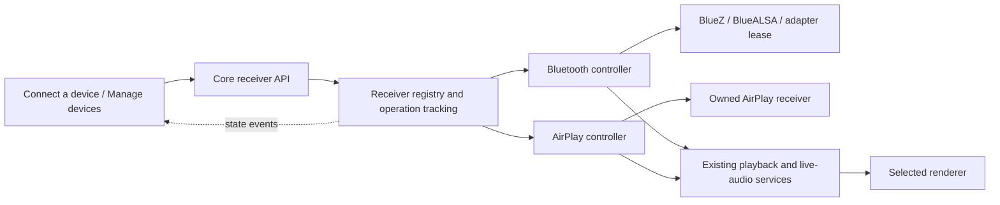

# Receiver controls and device management

Status: proposed, 2026-11-02. This is a control and UI design; the interfaces below are not implemented yet. It extends the [Bluetooth and AirPlay media design](bluetooth-audio-sink-design.md) without changing PCM transport, renderer selection, or playback ownership.

## Decision

Add an optional **receiver-control capability** to input plugins. Core discovers and routes it; the app renders a common **Connect a device** panel. Bluetooth and AirPlay supply their own discovery, session and device-management behavior through this interface.

Persistent plugin settings remain settings: enabled, advertised name, supported codec preferences and expert tuning. Pairing, discovery windows, disconnecting a sender, and granting/revoking access are immediate operations in device management. They never enter the staged-settings Apply/restart flow.

The capability is independent of `LiveAudio`: a plugin can receive playback through `DirectPlayback` or `ExternalPlayback` and still expose receiver controls. Existing input and output plugin types remain intact.

### Alternatives considered

| Approach | Tradeoff |
|---|---|
| Keep discovery and device actions in the settings schema | Smallest change, but transient operations remain mixed with saved configuration, restart rules and staged edits. It also provides no useful session/request lifecycle. |
| Add Bluetooth- and AirPlay-specific Core routes and app screens | Straightforward initially, but every new receiver requires protocol-specific changes throughout Core and the app. |
| Optional, typed receiver controller | Recommended. One small control contract supports shared presentation while plugins retain protocol policy. Existing plugins need no changes. |

## What exists today

| Existing component | Consequence for this design |
|---|---|
| `PluginBase` has optional hooks and `InputModulePlugin.get_interface()` returns the browsing/input interface. | Add a separate optional controller; preserve the existing interface and defaults. |
| `PreparedPlugin.setup()` instantiates disabled plugins but skips their setup and interface registration. | Static receiver metadata must be readable without starting the plugin. Runtime controllers are usable only after setup. |
| Bluetooth implements `pair_phone`, `authorize_device`, and `forget_device` as immediate one-shot config fields. | The backend operations can be reused, but their public presentation moves out of configuration. |
| Bluetooth audio grants are stored separately from BlueZ bonds. The supervisor shares BlueZ for setup. | Revoking audio access and removing a Bluetooth pairing must remain distinct operations. |
| AirPlay owns `Receiver`/shairport-sync and starts it during plugin setup. Its wrapper currently exposes start/stop, not independent advertisement control or a trustworthy persistent sender-device list. | AirPlay initially exposes receiver availability and current-session information. It must not pretend to support Bluetooth-style pairing, per-device grants, or non-disruptive advertisement withdrawal. |
| Home sources are filtered by the `catalogs` capability. | Receivers need their own discovery capability; do not invent a browsable Bluetooth/AirPlay catalog. |
| Module snapshots and events already keep plugin health current. | Reuse the event connection, with a separate receiver snapshot so pairing changes do not churn the settings schema or playback state. |

Local implementation references: [SDK plugin contracts](../packages/kalinka-plugin-sdk/src/kalinka_plugin_sdk/plugin.py), [plugin lifecycle](../packages/kalinka-server/src/kalinka_server/player_setup.py), [Bluetooth plugin](../packages/kalinka-plugin-bluetooth/src/kalinka_plugin_bluetooth/__init__.py), [Bluetooth pairing/access](../packages/kalinka-plugin-bluetooth/src/kalinka_plugin_bluetooth/pairing.py). AirPlay behavior above is based on the sibling `kalinka-plugin-airplay` checkout at `ad98729593e02377d9708a99a8fee60f593fbc81`, specifically its `__init__.py`, `receiver.py`, and `shairport.py`.

## User experience

### Access points

Place a labelled **Connect a device** action beside Home's music sources, and the same action in the streamer menu. Both open one panel for the currently connected Core. Keep it available when an installed receiver plugin is disabled or unhealthy; explain that condition in its row. It does not depend on the public plugin catalog being enabled or reachable.

On phones, use a sheet; on tablets, use the existing side-panel treatment. An active Bluetooth/AirPlay input badge also opens this panel at that receiver. Keep the selected output visible and use the existing output picker to change it.

```text
Connect a device
Receiving on: Kitchen Kalinka
Play through: Living-room renderer                 Change

Bluetooth
Visible as “Kitchen Kalinka” when pairing is open
[Pair a device]                          [Manage devices]

AirPlay
Available on this network as “Kitchen Kalinka”
[How to connect]                         [Stop receiving]
```

This is one access point, with protocol-specific actions. There is no combined “advertise everything” switch: Bluetooth uses a short pairing window, whereas AirPlay normally remains available on the network while its receiver runs.

An unavailable output is shown beside **Play through**, separately from receiver health. Opening discovery does not acquire a renderer, interrupt the queue, or claim playback. Audio arriving later goes through existing arbitration. Changing output does not change which machine receives Bluetooth or advertises AirPlay.

### Bluetooth flow

1. Tap **Pair a device**. The plugin obtains its adapter lease, registers its agent and opens a two-minute window immediately. Keep the current music playing.
2. Show the effective Bluetooth name, “Select this name in your device's Bluetooth settings,” a countdown, and **Stop pairing**. Closing the panel leaves the bounded window running.
3. On successful pairing through this audio workflow, grant audio access automatically and close the window once the pairing/authorization handshake has completed. Show “Pixel 9 Pro can now play audio.” Pairing success alone does not take playback away from another input.
4. Remembered, allowed devices can reconnect without reopening discovery. After timeout, only the new-device window closes; existing sessions and grants remain.

**Manage devices** uses readable device names and explicit states: connected, playing, saved, or “Paired; audio not allowed.” Show “Paired for setup” only when provisioning supplies that provenance; a BlueZ bond alone does not establish why it exists. An already bonded device can offer **Allow audio** here, with an explanation. It is not a second required step after ordinary audio pairing.

Device actions have exact meanings:

| Action | Effect |
|---|---|
| Disconnect audio | End the current audio session; keep its audio grant and Bluetooth bond. |
| Remove audio access | Persistently revoke Kalinka audio access and end this peer's active audio. Preserve its setup permission and bond. |
| Remove Bluetooth pairing | Remove the shared bond, if the backend can coordinate this safely with provisioning. Explain the effect on setup/reconnection before executing. |

Full bond removal is not offered in the first Bluetooth adapter until that coordination exists. Do not label an audio-only revocation “Unpair” or “Forget device.” Avoid disconnecting an entire shared Bluetooth device when only its audio profile should end.

### AirPlay flow

When available, show the actual advertised name and instructions to select it in the sender's AirPlay output menu. When the enabled receiver has been stopped, offer **Make available**; start its owned receiver and publish readiness without restarting Core.

For the current wrapper, **Stop receiving** stops the receiver, withdraws its advertisement and can end an active AirPlay session. During playback, show that consequence and require an explicit stop choice. Do not call it “Stop discovery,” which would imply existing playback continues. A future backend that can independently control advertisements may expose that additional action.

Discovery, admission and disconnection are separate: withdrawing an advertisement alone is not an access-control guarantee. Conversely, stopping Bluetooth pairing does not block a remembered phone from reconnecting.

AirPlay initially offers no saved-device allow list. Current-session sender details are informational, not proof of a stable authenticated identity. If a future backend provides real pairing/access requests, it opts into the corresponding management capability. Do not infer access permissions from IP addresses, hostnames, or a name shared with a Bluetooth peer.

### Persistent settings and disabled receivers

Bluetooth settings contain **Enabled**, **Bluetooth name**, and optional **Codec preference** when the installed backend supports meaningful choices. Prefer **Automatic**; advertise only supported codecs. AirPlay keeps its enabled flag, speaker name and applicable receiver settings. Technical tuning stays in Expert settings.

The panel can offer **Enable Bluetooth** or **Enable AirPlay** for an installed, disabled plugin. This explicitly persists only its existing `enabled` setting and starts that plugin. It does not silently enable it just because the panel was opened or discovery was requested. Reconcile that exact field in the app while preserving unrelated staged edits.

A name or codec change may need to restart that receiver and interrupt its input; show that effect where the setting is applied. It must not require restarting Core. For Bluetooth, the advertised name is an adapter-wide BlueZ alias: its update must be coordinated with the supervisor's use of the shared adapter. The panel displays the effective name, not just the requested config value.

## Optional SDK contract

Add a small module such as `kalinka_plugin_sdk.receiver_control`. The following is illustrative API shape:

```python
class InputModulePlugin(...):
    RECEIVER: ClassVar[ReceiverDescriptor | None] = None

    def get_receiver_control(self) -> ReceiverControl | None:
        return None

class ReceiverControl(Protocol):
    async def snapshot(self) -> ReceiverSnapshot: ...
    async def execute(self, command: ReceiverCommand) -> ReceiverResult: ...
```

`RECEIVER` declares a contract version, presentation identity and supported control families. It is plain data readable before setup. The optional controller is attached after successful setup, and removed before shutdown. Core derives the `receiver_control` module capability from this declaration rather than from plugin IDs or the public feed.

Use typed SDK models and a discriminated command union, not arbitrary method names, URLs, Python callbacks supplied by clients, or a general plugin-generated UI schema. Receiver controls remain a small domain interface. New optional capabilities can be added without imposing them on every plugin.

### State and capabilities

Keep these concepts separate in `ReceiverSnapshot`:

| Field | Meaning |
|---|---|
| Receiver identity | Core/plugin-scoped ID, title and contract version. One receiver per plugin initially. |
| Lifecycle | Desired enabled setting plus actual `disabled`, `starting`, `ready`, `stopping`, or `error` state. |
| Effective name | What a sender should look for; may be unknown while unavailable. |
| Visibility | `hidden`, `advertising`, or `unknown`, and optional expiry/window ID. |
| Admission | Whether new devices can join, require approval, or must already have permission. |
| Sessions | Current senders, connection/playback state, and opaque session IDs. This is independent of device trust and current output ownership. |
| Peers | Optional saved devices with opaque IDs, pairing and audio-permission state. |
| Requests | Optional pending approval challenges with opaque IDs, expiry and supported responses. |
| Actions | Supported operations currently available, their target type, unavailable reason and playback effects. |
| Freshness | Core boot epoch, plugin runtime generation and snapshot revision. |

Use explicit capabilities for timed pairing, receiver availability, independent advertisement control, saved peers, access requests, audio-session disconnect, and bond removal. Absent capabilities mean absent controls. An available action must still be revalidated by the plugin when executed.

Known effects include `none`, `ends_target_audio`, and `restarts_receiver`. Core never lets a plugin declare that an ordinary receiver action needs to restart the streamer. Destructive/effectful actions carry an explicit acknowledgement of the presented effects; effects are checked again if state changes before execution.

### Commands

| Command family | Arguments and semantics |
|---|---|
| Open/close pairing window | Bounded duration; closing names the window ID. Bluetooth initially defaults to 120 seconds. |
| Set receiver availability | Start/stop the protocol receiver; stopping may require acknowledgement that the active input ends. |
| Set advertisement visibility | Only supported where it can be changed independently of receiver/session lifetime. |
| Disconnect audio session | An opaque current session ID; preserve saved access. |
| Grant/revoke audio access | An opaque peer ID; applies only to this plugin's audio permission. |
| Remove pairing | An opaque peer ID, only when advertised as supported, with explicit effects. |
| Respond to access request | Opaque request ID and one of the challenge's allowed answers; cannot approve an expired/replaced request. |

A shared command family does not require every plugin to implement every command. In v1 Bluetooth exposes pairing, saved-peer audio grants and audio disconnect; AirPlay exposes availability and current-session information. Session disconnect is offered only when the adapter has a working implementation; stopping the whole receiver remains a distinct action.

Permission policy belongs to the plugin/backend. Core routes approved app commands and never equates a Bluetooth setup bond with audio permission. Opening a pairing window is the user's explicit consent to admit a newly paired audio device during that window. If a backend supports a separate approval challenge, show it as a request rather than a config field.

## Core routing and plugin lifecycle



Core owns inventory, command validation, lifecycle serialization, operation tracking and event delivery. Plugins own protocol state and enforcement. The app owns presentation using standard control semantics. Renderer settings and output selection continue to use their existing APIs.

Introduce a registry fed by the existing `PreparedPlugin` collection. Disabled, incompatible and failed receiver plugins remain listed with a reason and no callable controller. Avoid constructing a second plugin instance for management. Registration/removal follows the same lifetime as the existing input interface, health reporting, dynamic fields and option resolvers.

Live enable/disable requires an explicit, limited lifecycle addition: receiver plugins opt into safe per-plugin setup/shutdown. The existing config service persists the desired enabled value; a lifecycle coordinator starts/stops only that prepared plugin and refreshes its registrations and module events. Disabling releases that plugin's playback hold and resources through normal ownership APIs. Do not power down BlueZ or stop shared services used by setup or another owner.

Make apply effects additive metadata/results in the config API: `live`, `restart_plugin`, or `restart_core`. New clients honor them; existing plugins retain their existing restart behavior unless they opt in. Receiver fields declare the appropriate effect. No automatic fallback from failed plugin startup to restarting Core. Preserve the desired setting and expose the failed actual state with a bounded retry operation.

Serialize configuration application and commands for the same plugin. Invalidate the runtime generation before unloading it, cancel old operations, and ignore late callbacks. Update the existing prepared-plugin registrations rather than bypassing `PreparedPlugin.health_state` or maintaining a second enabled-module list. Installation of missing system packages remains the existing software-management workflow; discovery never starts an installation implicitly.

## API and events

Proposed endpoints:

```text
GET  /receivers
GET  /receivers/{receiver_id}
POST /receivers/{receiver_id}/commands
GET  /receivers/{receiver_id}/operations/{operation_id}
```

Commands carry a client request ID, the Core boot epoch and receiver runtime generation, a typed operation and its typed target/arguments. A close-window command carries its window ID; a permission response carries its request ID. The backend validates these against current state so a stale app cannot close a newer window or authorize a different phone. Do not reject commands merely because an unrelated metadata or progress update incremented a snapshot revision.

Core accepts a command once and returns `202` with an operation ID; completion is reported through operation state and a new snapshot. Immediate validation failures use structured errors. A bounded idempotency cache makes network retries return the same operation; repeating “open pairing” does not extend a window by accident. Operations are scoped to a Core boot/plugin generation and are never replayed after restart. Reconnect fetches current state rather than resending commands.

Publish the retry/deduplication lifetime; after it expires, the client reconciles state instead of retrying a historical operation. Reject reuse of a request ID with different arguments. An explicit request to open an already-open pairing window returns the existing window without extending it.

Core runs `execute()` as a tracked, bounded task; its return means the requested transition has completed. Opening pairing completes when the window is open, not when a phone eventually pairs or the timer expires. Pending approval requests live in the snapshot independently of HTTP requests. Operations report `pending`, `running`, `succeeded`, `failed`, or `cancelled`; backend timeouts must trigger cleanup/reconciliation so a late result cannot silently reopen a cancelled window. Snapshot reads use cached state and never wait for a pairing handshake.

Use stable errors such as `plugin_disabled`, `backend_unavailable`, `unsupported_operation`, `adapter_busy`, `stale_target`, `permission_request_expired`, and `effects_changed`. Known refusals become appropriate 4xx responses with readable messages; failed backend work becomes an operation failure, not an unexplained perpetual spinner. No generic HTTP 500 for unsupported receiver capabilities.

Add `receivers_changed` and `receiver_operation_changed` messages to the existing app event connection, plus a receiver snapshot on replay. An optional context notifier lets plugins signal a changed cached snapshot. Core validates plugin ownership and coalesces duplicate updates. These notifications contain control state, never PCM blocks or sample-rate progress events.

The app uses server time/expiry to render a local countdown; the backend's monotonic deadline is authoritative. Backgrounding or closing a panel does not prolong the window. After disconnect, show state as unavailable until refreshed; do not claim that a stale countdown is a live advertisement.

Routes use the same access boundary as other streamer-management operations and must enforce any configured controller authorization. A device being approved to send audio does not gain permission to manage other devices or the streamer. Pairing prompts and permission decisions are never accepted solely because the requesting peer supplied a familiar display name.

## Backend-specific work

### Bluetooth

Move the existing pairing window and `AudioAccess` operations behind the controller. Add runtime snapshots and exact device/session action semantics. Track provisional authorization during the handshake; persist new grants only after successful audio pairing and reconcile failed or cancelled attempts. Do not unregister the agent midway through the successful handshake. Use the actual BlueZ object path resolved from the opaque peer, since a device's identity address can differ from its original object path.

Keep the shared adapter lease for global agent/discovery/name changes. Return `adapter_busy` while provisioning owns it. Add scoped backend/D-Bus permissions only for operations actually implemented. Stop pairing must restore adapter properties and release the lease without stopping established audio. Revocation must stop this peer's current playback as well as remove its saved grant.

Kalinka audio grants are separate from BlueZ's device-wide `Trusted` property. Coordinate trust changes with provisioning; revoking an audio grant must not blindly clear shared device trust. Enforce the audio grant on every new or resumed audio transport, rather than relying on discoverability or trust alone.

Expose only codecs the backend can receive, with Automatic as the default. Codec configuration is separate from a peer's right to send audio. This management extension does not change the existing SBC/PCM media path or add transcoding.

### AirPlay

Separate plugin initialization from the desired running state of its owned receiver. Reuse the current start/stop supervision for availability. Track actual readiness and the effective advertised identity; process creation alone is not proof that service advertisement succeeded.

Respect the difference between a stopped receiver and an unexpectedly failed child: an intentional stop must suppress automatic restart. A transient stop is not a change to the plugin's enabled setting; after a Core restart an enabled AirPlay plugin returns to its documented default of available. Bluetooth always boots with new-device pairing closed. Show these semantics in the panel/help.

Initially omit independent advertisement withdrawal and persistent peer permissions. Add them only after verifying the bundled shairport-sync build can implement the required behavior and identity guarantees. The controller contract supports those extensions without an AirPlay-specific branch in Core or an app redesign.

## Compatibility and migration

1. Ship an additive SDK minor release with default `RECEIVER = None` and optional context notifications. Leave `get_interface()`, browsing, `DirectPlayback`, `ExternalPlayback`, and `LiveAudio` unchanged.
2. Add the Core registry, structured operations, events and scoped plugin lifecycle. Expose a receiver-control API version so clients feature-detect support. Preserve existing plugin APIs and restart behavior for non-opted-in plugins.
3. Add the Bluetooth controller. For one compatibility period, keep old one-shot config inputs as deprecated adapters to the same controller. Hide them from the new presentation schema. Do not maintain two independent pairing implementations.
4. Add the AirPlay availability controller. Its capabilities accurately reflect its current wrapper. Preserve installed users' existing enabled/available default.
5. Add the app entry points and shared panel. On older Core versions, show the existing settings link with a clear “Update the streamer for device controls” explanation. Do not fake live operations with a restart.
6. Remove deprecated Bluetooth management fields in a later documented breaking release after clients have migrated. Persisted device grants/bonds survive this migration; transient pairing actions never run merely because settings were loaded.

A plugin with no receiver descriptor is unaffected. Unknown optional action types are ignored by older clients; the server still checks capability/contract compatibility before dispatch. Installed-plugin inventory drives visibility even for unpublished plugins.

## Acceptance criteria

- Discovery is reachable from Home in two taps and never restarts Core. Opening discovery or the panel never claims an output.
- Bluetooth pairing shows the effective name, countdown and cancellation. It closes on success/timeout while remembered-device playback remains usable.
- Successful ordinary audio pairing needs no separate grant step. Existing bonds without audio permission are clearly labelled and can receive an explicit audio grant.
- Audio revocation takes effect for the active sender and preserves provisioning credentials. Full unpairing is absent until safely implemented.
- AirPlay can become available through the same panel; stopping an active receiver explains the actual interruption. Unsupported pairing/device-permission controls are absent.
- Per-plugin enable/disable updates health, input registration and control availability without a Core restart or unrelated audio-service changes.
- Two app clients, network retries, a stale window/request, app backgrounding and a plugin/Core restart cannot duplicate or resurrect operations.
- A discovery/permission operation cannot mutate the saved queue, reset renderer selection or replay old PCM. Switching output leaves receiver identity/discovery unchanged.
- Missing backend, adapter conflict, unsupported action and expired approval all produce finite, readable states.
- Old plugins load unchanged; old clients retain their existing behavior; new clients discover unsupported servers explicitly.
- Panel actions have 48dp targets, descriptive labels, visible busy/error state, and stable focus. Large text, narrow/landscape layouts and screen-reader announcements work without reading the countdown every second.

The latency-reporting/lip-sync work remains in the media design. This interface may surface a later sync-settings link, but discovery and permission management do not acquire ownership of timing, compression or audio buffers.
